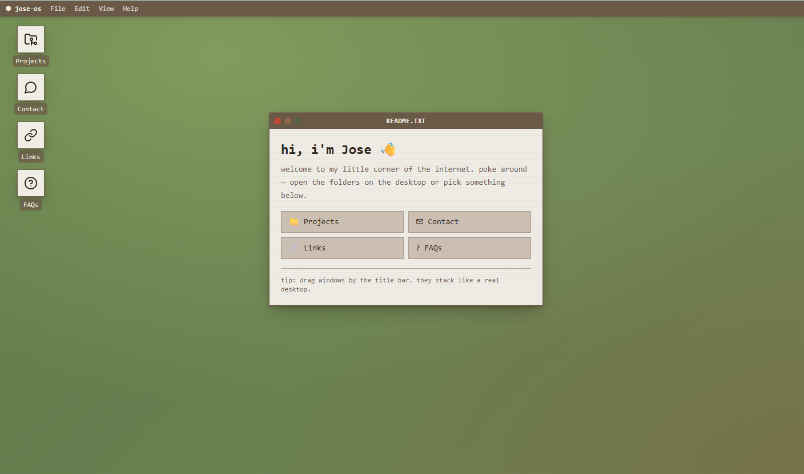

# JOSE-OS — Portfolio Desktop

My personal portfolio, built as a retro desktop OS. It boots up like an old
terminal, then you open windows to explore my projects, blog, links and contact info.



## Features

- **Boot screen** and draggable, stackable windows with a taskbar
- **Projects**: write-ups, screenshots and demo videos for homelabCD and KubesTUI
- **Blog**: posts about my Kubernetes homelab journey, with images and video
- **Game**: an ASCII fight on a canvas, me (the mage) vs the bug that broke SSH
- **Contact, Links, FAQs and About Me** windows

## Tech stack

React 18 · TypeScript · Vite · Tailwind CSS · shadcn/ui · lucide-react · Vitest

## Run locally

```bash
npm install
npm run dev      # http://localhost:8080
```

Other scripts: `npm run build`, `npm run preview`, `npm run lint` and `npm test`.

## Project structure

```
src/pages/Index.tsx            desktop, windows, projects and blog posts
src/components/desktop/        BootScreen, Window and the AsciiFight game
src/components/ui/             shadcn/ui components
public/                        images and videos used by posts and projects
```

To add a blog post, add an entry to the `posts` array in `src/pages/Index.tsx`.
Each post is made of text, image and video blocks.
